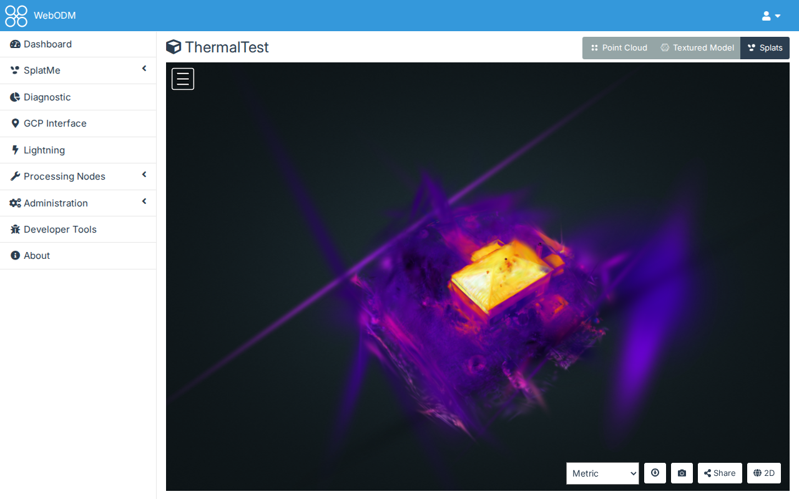

# SplatMe

A [WebODM](https://github.com/WebODM/WebODM) plugin that trains a task's Gaussian splats automatically.

WebODM can export a task's training data and display a trained splat model, but the training itself is done by
hand in other software. SplatMe does that step: one button on its Tasks page trains a task's splats on a GPU and
puts the model in the task's 3D view. A task can also be set to train by itself when its processing completes.

**[Getting Started](https://winuxnomacs.github.io/webodm-splatme/getting-started/)**: a fresh install from start
to a first trained model, and an upgrade, step by step.
**[Documentation](https://winuxnomacs.github.io/webodm-splatme/)**: installing, upgrading and uninstalling,
using SplatMe, the splat node, the plugin's API and development.

## Requirements

- WebODM 4.0.0 or later, installed with Docker (not WebODM's native Windows app).
- An NVIDIA GPU that Docker can use, on WebODM's machine or another one, for the training container (the
  "splat node").

## Status

**Experimental.** It has been used on WebODM 4.0.0 in Docker with an 8 GB NVIDIA GPU. See the
[releases](https://github.com/WinuxNomacs/webodm-splatme/releases) and their [changes](CHANGELOG.md). Problems
and ideas go in the repository's [issues](https://github.com/WinuxNomacs/webodm-splatme/issues); what is planned
is in [upcoming-changes.md](upcoming-changes.md).

## Licence

AGPL-3.0, see [LICENSE](LICENSE).
