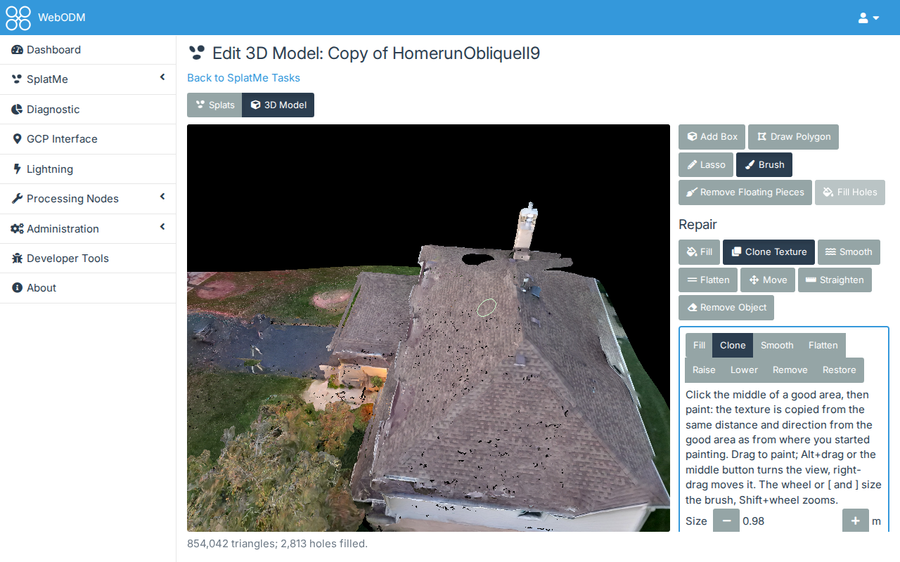

# Editing the 3D Model

WebODM's textured 3D model often has small holes where no photo saw the surface, loose bits floating around the
scene, bumpy roofs and walls, crooked gutters, broken shingles, parts sitting too low, and things you would rather
not show (a parked car, a person). **Edit** repairs it: it removes pieces, fills holes, flattens, smooths,
straightens and moves surfaces, removes objects, and copies the texture of a good area over a bad one. Most
repairs are adjusted a step at a time. The edits are kept with the task, and the model's original files are kept
too, so nothing is lost.

## Opening the Editor

On **SplatMe → Tasks**, **Edit** on a task's row opens the editor for those who may change the task's project.
Above the view, **Splats** and **3D Model** switch between the task's splats ([Editing Splats](editing.md)) and
its textured model; a task with only a textured model opens on **3D Model**. The view shows the model as
WebODM's 3D view does, with the edits' panel to its right, or below it on a phone.

A task can be edited once WebODM has made its textured model (its GLB, OBJ and MTL files).

## The Edits

The repairs most work needs are on the **Brush** (B), which paints on the surface ([The Brush](#the-brush)). The
**Repair** buttons under the tools start each repair: **Fill**, **Clone Texture**, **Smooth**, **Flatten** and
**Remove Object** start the Brush in that mode ([Remove Object](#remove-object)); **Straighten** asks for a line
([Straighten](#straighten)); **Move** adds a box that moves what it covers, in the middle of the model, to move and
size like any box.

**Add Box** (X), **Draw Polygon** (P) and **Lasso** (L) are for large areas, drawn as on Editing Splats (see
[The Edits](editing.md#the-edits) there). A shape acts on the triangles whose centres it covers. What it does is
chosen in the list:

- **Remove Inside** (the start) and **Keep Inside**: remove the triangles inside it, or all the others.
- **Remove Object** (a polygon or lasso): removes the object it outlines ([Remove Object](#remove-object)).
- **Move Inside**: raises, shifts or stretches what it covers: a roof that sits too low, an eave that should sit
  above the wall below it. The move fades to nothing over a **Soft Edge** around it, so the surface stretches
  instead of tearing.

### The Brush

On the 3D model, the **Brush** paints on the surface: a circle lies on the surface under the pointer, its size in
metres, and a drag paints along the surface. It acts only on the surface it covers that faces you, never on what
is behind it. The buttons above its panel choose what it does:

- **Fill**: fills each hole whose whole edge is under the circle, with the texture of the surface beside it. Paint
  over the holes, edge to edge.
- **Clone**: copies the texture of a good area. Click the middle of the good area, then paint where it should go:
  the texture comes from the same distance and direction from the good area as from where you started painting,
  so a stroke beside the first one carries on from it. The holes under the paint are filled with it too. **Pick the
  Source Again** starts over from another area.
- **Smooth**: evens out bumps and broken surface (lumpy walls, bent or broken shingles); each stroke smooths more.
- **Flatten**: makes what it paints flat, onto the plane of its edge: a bumpy roof face, a wavy wall. Paint one flat
  surface at a time: a stroke over a roof's ridge flattens both sides into one plane.
- **Raise** and **Lower**: lift or lower the surface by **Step** (2 cm at first) each stroke, the most at the
  middle of the circle.
- **Remove** and **Restore**: remove what it paints, or bring back what the edits above it removed.
- **Remove Object**: removes the object painted over ([Remove Object](#remove-object)).

Each drag is one **Undo**. Where the surface under the pointer jumps (off an eave down to the ground), the stroke
ends and starts again on the new surface instead of painting through the air between them. A mode's strokes are
one edit in the list (**Fill Brush, 3 strokes**) until the mode, the step or Clone's source changes, which starts
another. The wheel, or **[** and **]**, make the brush larger or smaller (**Size** in the panel, 4 cm to 10 m
across), and Shift+wheel zooms. While painting, a drag paints: Alt+drag or the middle button turns the view, and
right-drag moves it; on a phone, one finger paints and two fingers turn and zoom the view. **Done** or Escape
stops.

### Remove Object

**Remove Object** takes an object off the surface it stands on: a vent or a pipe on a roof, a car, a sign. Paint
over the whole object with the Brush, its foot too, or outline it instead: **Lasso** (drag round it, on screen) or
**Polygon** (click its corners in the view from above), beside **Done** in the Brush's panel. The surface round
what you marked tells where the object stands: inside the mark, what rises above that surface goes, whatever its
height, and what is below it (the house under a roof) stays. Where the object stood, the surface is laid again,
flat, with the texture round it, which also takes away the object's colours that photo texturing often leaves on
the surface at its foot. Mark a little round the object: the new surface's texture comes from just outside the
mark. **Clone** can go over it after, for a pattern such as shingles.

### Straighten

**Straighten** makes a broken or wavy edge straight: a gutter, an eave, a ridge, a window frame. Trace the edge as
it is now: click points along it on the model, starting where it is straight at one end and ending where it is
straight at the other; a line follows the pointer from the last point. Double-click the last point, or **Finish**,
to end it (at least 3 points); Backspace takes back the last point, and Escape stops. The edge is then made straight
between the first and last points: each place on the traced line moves to the place as far along the straight line
(shown dashed), and the surface near it moves with it by the same amount, so a gutter stays whole and the roof
behind it stretches. Everything within **Reach** of the traced line (30 cm at first) moves fully, and the move fades
to nothing over a **Soft Edge** past it (50 cm at first). **Strength** starts at 100%, fully straight: **-** steps
it back toward where the edge was. **Start Height** and **End Height** raise or lower the straight line's first or
last end (where the tracing began or ended), each on its own: the line tilts about its other end, so an eave can be
made level, or set to a pitch. Picked in the list, any point of the line can be dragged on the model, or
**Draw the Line Again**; while a line is traced, the view leaves its edit out, so what it hid can be clicked.

The picked edit's settings show under the list, each with **-** and **+** to change it a step at a time, and each
step is one **Undo**: Move Inside's **Up**, **East** and **North** (5 cm a step), **Stretch East**, **Stretch North**
and **Stretch Up** (5%) and **Soft Edge** (0.25 m); Straighten's **Strength** (10%), **Reach** (5 cm), **Soft
Edge** (10 cm), and **Start Height** and **End Height** (5 cm). The view
shows each step as it is made.

Two tools act on the whole model, once each:

- **Remove Floating Pieces**: removes the pieces of surface apart from the rest with fewer triangles than its size:
  **Small** (100), **Medium** (1,000, the start) or **Large** (10,000), or any number up to 100,000. The largest
  piece is never removed. The list says how many triangles it takes.
- **Fill Holes**: fills every hole with up to its size of edges around it: **Small** (10, the start), **Medium**
  (50), **Large** (200) or **Very Large** (1,000), or any number up to 5,000. The list says how many it fills. The
  larger sizes take the few wide holes too, which take the longest to texture: on an 850,000-triangle model, Very
  Large adds a few seconds each time the editor opens it.

Each one's size is a field in the list: type a number and press Enter (or leave the field), or pick a suggested size
from the menu beside it.

The edits apply in the list's order: a fill closes its hole for the edits below it, and a restore brings back
only what the edits above it removed. The model's outer edge is never filled, nor a hole of more than 5,000 edges. A fill goes when a later edit takes
away the surface round it.

A filled hole 20 cm or more across takes the texture of the surface beside it, repeated across it and blended into
the colours at its edge, so a removed object leaves lawn, gravel or roof in its place. A smaller hole is coloured
from its edge, blended across it. Where a removed object's hole joins older holes beside it, the fill spans them
all and can cover some of the ground around them: draw the shape again, smaller. The **Clone** brush over a fill
replaces its texture with one you choose.

The view shows the edits as they change, by the same rule **Update the Model** uses, and the line under it says
how many triangles the model has, how many the edits remove and retexture, how many points they move and how many
holes they fill. **Undo**, **Redo**, **Clear Edits**, the keys, moving around (a double-click centres the view on
the surface under the pointer) and saving work as on [Editing Splats](editing.md#moving-around), and
[Measuring](editing.md#measuring) too, on the model's surface.

## Updating the Model

**Update the Model** makes the task's textured model again with the edits: the GLB that WebODM's 3D view and the
share links show, and the OBJ with its MTL that the **Textured Model** download gives. It takes seconds (about 7
to 10 for an 850,000-triangle model). Under the button, the editor says whether the task's model has the edits as they
are now. **Cancel**, beside the button while it runs, stops it and leaves the model as it was.

The first update keeps the model's original files in the task's `data/splatme/model` folder, and every update
starts from them, so edits never pile up. To make the model whole again, **Clear Edits**, then **Update the
Model**. The Clone brush and the wide fills share one texture of at most 16,384 pixels a side: an update that
needs more is refused and says so (clone less of the model, or fill fewer wide holes).

**Textured Model (3D Tiles)** and **All** in WebODM's Download menu keep the unedited model, for anyone who may
download the task: an object or a person removed in the editor can still be seen there.

A task processed again gets a new model from WebODM. Its edits stay in the list: press **Update the Model** to
apply them to the new one.
