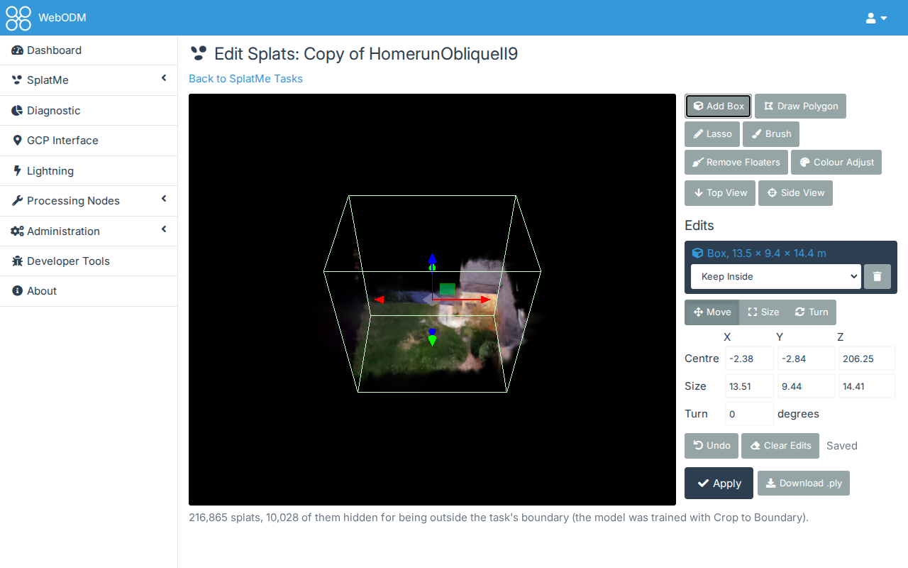

# Editing Splats

A trained model often has haze and stray splats around the scene (floaters), or more ground than you want to
show. **Edit** crops it to the part you want, removes what you don't and can adjust its colours. The edits are kept
with the task and cut a copy of the model SplatMe trained, so nothing is lost. A training of the task, later
(**Continue From Step** or a new one), applies them again.

## Opening Edit Splats

On **SplatMe → Tasks**, a task whose splats SplatMe trained has **Edit** beside **View in 3D**, for those who may
change the task's project. It opens **Edit Splats**: the trained model in a 3D view, with the edits' panel to its
right, or below it on a phone. Anyone who may see the task has **Download .ply** instead.

The page loads the trained model whole into the browser. A model larger than 400 MB (about 1.7 million splats)
asks first: it may be slow, or fail on a phone or a computer with little memory.

There is no **Edit** for a task whose model came from WebODM's own **Splats** dialog, or whose model was
replaced there since its training: only a model SplatMe trained can be edited.

## The Edits

Each shape **Keeps Inside** (removes everything outside it) or **Removes Inside**, chosen in the list; the
**Brush** removes or restores, and **Remove Floaters** only removes. The edits apply in the list's order, so a
restore brings back only what the edits above it removed.

The view hides what the edits remove as you change them, by the same rule **Apply** uses, and what lies outside
the task's boundary when the model was trained with **Crop to Boundary**.

- **Add Box**: a box over the middle of the model. Its handles **Move** it, **Size** it and **Turn** it about the
  vertical. The fields under the list set its centre, size and turn exactly, in metres and degrees.
- **Draw Polygon**: the view turns to look straight down. Click the corners, then click the first corner, or
  double-click, or press **Finish** (Enter) to close it. Escape or **Cancel** stops. A polygon cuts at every
  height.
- **Lasso**: drag around what to remove, in any view (one finger on a phone); letting go closes it, and Escape or
  **Cancel** stops. It takes everything inside it on screen, through to the back, so turn the view first until
  what you want gone is apart from what you keep. **Go to Its View**, beside it in the list, turns the view back
  to where it was drawn.
- **Brush**: paint over what to remove (one finger on a phone). Like the Lasso, it takes everything under the
  brush on screen, through to the back. The view holds still while you paint, so the strokes until **Done** (or
  Escape) are one edit in the list ("Brush, 3 strokes"), and **Undo** takes back the last stroke; turn the view
  between sessions. **Size** sets the brush's width on screen, from 5 to 100 pixels; the [ and ] keys change it
  too. **Go to Its View** works as for a lasso.

    **Restore**, in the brush's panel, paints back instead ("Restore Brush" in the list): everything under the
    brush that the edits above it removed comes back, whether a shape, a lasso, the brush or **Remove Floaters**
    took it out. It never brings back what **Crop to Boundary** leaves out. Switching between **Remove** and
    **Restore** starts a new edit in the list.

- **Remove Floaters**: removes the splats far from the rest and the oversized ones (the smears and streaks across
  the sky), judged on the whole trained model. Its strength, in the list, is **Light**, **Medium** (the start) or
  **Strong**; the list says how many splats it removes besides those **Crop to Boundary** already leaves out. A
  task has one.
- **Colour Adjust**: changes the whole model's **Brightness**, **Contrast**, **Saturation** and **Warmth** (more
  red and less blue, or the reverse). Each slider goes from -100 to 100 and starts at 0, no change; pick it in the
  list to show its sliders again. The view leaves out the part of a colour that changes with the viewing angle
  (shine, a sky's tint on a roof), so the applied model can look slightly different.

Once drawn, a shape is hidden from the view, which shows only what it cuts; pick its edit in the list to show
the shape again, and a box's handles and fields with it. **Undo** takes back the last change, and **Clear
Edits** removes them all. **Top View** and **Side View** frame the model again.

Edits are saved as you make them ("Saved" under the list); leaving the page before then asks first.

## Applying Them

**Apply** makes the task's model again from its trained model with the edits, as the end of a training does:
cut to the task's boundary first when it was trained with **Crop to Boundary**, then by the edits, then
recoloured by **Colour Adjust**. It takes as long as converting the model. WebODM's 3D view, the download and the
share links then show the edited model. **SplatMe → Tasks** shows the Apply while it runs, and **Edit Splats**
says when the edits have changed since the task's model was made.

To make the model whole again, **Clear Edits**, then **Apply**.

**Apply** is refused while the task's splats train, and a training is refused while edits are applied. Edits
that together remove every splat are not applied, and the model stays as it was. A training whose edits would
remove every splat imports its model without them and says so.

Edits saved by a newer SplatMe (or read by a WebODM not restarted since an upgrade) may not read: the page says
so, **Apply** fails with that reason, a training goes on without them, and both leave them as they are; a change
on the page replaces them.

## Downloading the Edited Model

WebODM's own download gives the task's model in its `.rad` format, which few other tools open. **Download .ply**,
beside **Apply** on **Edit Splats** and on the task's row on **SplatMe → Tasks**, gives it as a `.ply`, the
format the trainer writes and most splat tools open. It is made as **Apply** would make the model, with the task's
saved edits, so it has them even before they are applied; on **Edit Splats** the button waits until the edits are
saved. The `.ply` is up to about 250 bytes a splat (50 MB for 200,000). Anyone who may see the task may download it.

The model keeps the task's orientation: up is z, as in Blender, and north is y. Its z is the height above sea
level, so the model sits that high above the origin; x and y are close to it.

## The 3D View's Start View

WebODM's own 3D view keeps a start view for each task: turn the view as you want it, then press **set initial
camera view** under **Scene** in its sidebar. The task's 3D view and its share links then open there, with the
splats as with the point cloud.
