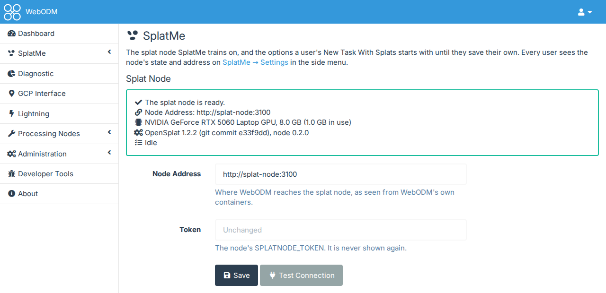
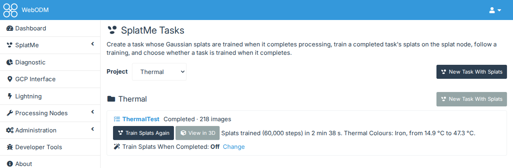

# Getting Started

This page walks through a fresh install, from nothing to a first trained model, then an upgrade. It is done by a WebODM administrator (a superuser)
with a terminal on WebODM's machine, and on the GPU machine if that is another one. The
[reference](install.md) has every option.

## Fresh Install

### 1. Check What You Need

- **WebODM 4.0.0 or later, running in Docker** (with `./webodm.sh`).
- **A machine with an NVIDIA GPU** (GTX 16 or RTX 20 to RTX 50 series): WebODM's machine or another one. It needs
  the GPU's driver, Docker with Docker Compose v2, and the
  [NVIDIA Container Toolkit](https://docs.nvidia.com/datacenter/cloud-native/container-toolkit/latest/install-guide.html).
  To check that a container can use the GPU before downloading anything large, run on that machine:

    ```
    docker run --rm --gpus all ubuntu nvidia-smi -L
    ```

    You should see your GPU listed (`GPU 0: NVIDIA GeForce …`). An error here means the driver or the NVIDIA
    Container Toolkit is missing; the splat node's install would stop at the same point.

- **A network path from WebODM to the splat node**, when the node runs on another machine. WebODM sends each
  training's photos to the node and asks it for progress and the model over HTTP, on the node's port (3100 unless
  installed with `--port`, or the port of an
  [HTTPS proxy](splat-node.md#https-to-a-node-on-another-machine) in front of it). Any firewall in between, on
  either machine or a device on the network, must let WebODM's machine connect to that port and the answers come
  back over the same connections. The node never connects to WebODM. On WebODM's own machine, nothing is needed:
  the node joins WebODM's Docker network.

### 2. Install the Plugin

In WebODM, open **Administration → Plugins**:

- If **Install Plugins** lists SplatMe (marked Experimental), press **Install**.
- Otherwise download `splatme-<version>.zip` from the
  [latest release](https://github.com/WinuxNomacs/webodm-splatme/releases/latest) and send it with **Load Plugin
  (.zip)** on the same page.

SplatMe then shows in the list of plugins.

### 3. Restart WebODM Once

In WebODM's folder, restart it with the options it was started with (`webodm.sh` does not remember them):

```
./webodm.sh restart
```

Add any options you gave `./webodm.sh start`, such as `--port`, `--hostname`, `--media-dir` or `--ssl`.

Until this restart, SplatMe's pages fail now and then and tasks are not trained by themselves.

**You should see**, after the restart: **SplatMe** in WebODM's side menu (with **Tasks** and **Settings**), and
**SplatMe** under **Administration**.

### 4. Install the Splat Node

The splat node is the container that trains, on the GPU machine. Open **Administration → SplatMe**: with no node
set yet, **Set Up a Splat Node** shows the commands, each with a **Copy** button. Choose the tab that fits:

=== "On WebODM's Machine"

    Run, on WebODM's machine:

    ```
    curl -fsSL https://github.com/WinuxNomacs/webodm-splatme/releases/latest/download/splatnode.sh | bash -s install
    ```

    It downloads the node's image (4 GB the first time; 6.6 GB once unpacked), checks the GPU, and starts the node
    on WebODM's Docker network. Its last lines include:

    ```
    WebODM found: webapp (network webodm_default)
    The splat node 0.3.0 runs with OpenSplat 1.2.2 (git commit e33f9dd) (folder /home/you/splatnode).
    SplatMe in WebODM (webapp) now trains on this node: http://splat-node:3100
    ```

    There is nothing to enter: **reload Administration → SplatMe**. With several WebODMs on the machine, the
    install stops and names them: run it again with `--webodm <its webapp container>`.

=== "On Another Machine"

    Run, on the GPU machine:

    ```
    curl -fsSL https://github.com/WinuxNomacs/webodm-splatme/releases/latest/download/splatnode.sh | bash -s install --standalone
    ```

    It downloads the node's image (4 GB the first time; 6.6 GB once unpacked), checks the GPU, starts the node on port 3100
    (`--port` for another), and prints its address and token:

    ```
    Enter these on SplatMe's page in WebODM (Administration > SplatMe), then press Test Connection:
      Address: http://192.168.1.20:3100
      Token:   3f9c…
    ```

    On **Administration → SplatMe**, enter them as **Node Address** and **Token**, press **Test Connection**
    ("The splat node answers and can train."), then **Save**. The connection is plain HTTP: let only WebODM's
    machine reach that port, or put an [HTTPS proxy](splat-node.md#https-to-a-node-on-another-machine) in front
    of it.

A failed install is undone, so it can be run again once the problem it names is fixed.

The node trains with [OpenSplat](https://github.com/WebODM/OpenSplat). To train with
[LichtFeld Studio](https://github.com/MrNeRF/LichtFeld-Studio) instead, add `--trainer lichtfeld` to the install
command ([Trainers](splat-node.md#trainers)).

**You should see**, on **Administration → SplatMe**, a green box: "The splat node is ready.", its address, your
GPU and its memory, the trainer and the node's version, and "Idle".



### 5. Train a First Task

1. Open **SplatMe → Tasks** in the side menu. It lists the tasks SplatMe can train: tasks whose photos are JPEG
   (or DJI Thermal Analyzer's TIFFs).
2. Press **Train Splats** on a task. For a quick first check choose the **Draft** quality (3,000 steps, about 2
   minutes on an 8 GB GPU), then **Start Training**.
3. The task's row shows the stage, then the step with the time left, a progress bar, **Cancel** and **Show Log**.

**You should see**, when it is done, **View in 3D** on the row, which opens the trained model in the task's 3D
view.



From here, [Using SplatMe](using.md) covers the options, continuing a training, and **New Task With Splats**,
which creates a task that trains by itself when its processing completes.

## Upgrade

Upgrade between trainings: a training running during an upgrade picks up again or fails with a message. Your
settings, users' options, tasks' trainings, trained models and edits are kept: they are in WebODM's database and in
the tasks, not in the plugin's folder.

### From 0.3.0 or Earlier to 0.4.0

0.4.0 needs splat node 0.2.3 for Grow Until and for datasets over 2 GB: upgrade the node too.

1. **The plugin**, on **Administration → Plugins**:
    - If **Install Plugins** shows **Update** for SplatMe, press it.
    - Otherwise delete SplatMe (its row's bin), then send `splatme-0.4.0.zip` from the
      [0.4.0 release](https://github.com/WinuxNomacs/webodm-splatme/releases/tag/v0.4.0) with **Load Plugin
      (.zip)**. WebODM refuses the zip while SplatMe is still installed, so delete it first.
2. **Restart WebODM once**, with the options it was started with, as in a [fresh install](#3-restart-webodm-once).
   Until then, **Update the Model** and **Continue From Step** fail: WebODM's worker still runs the old plugin.
3. **The splat node**, on its machine:

    ```
    curl -fsSL https://github.com/WinuxNomacs/webodm-splatme/releases/latest/download/splatnode.sh | bash -s upgrade
    ```

    It downloads the newest image, restarts the node keeping its jobs, token and port, and deletes the previous
    image. It ends with:

    ```
    The splat node runs version 0.2.3 (it was 0.2.2). Its jobs and token are kept.
    The previous image was deleted.
    ```

**You should see**, on **Administration → SplatMe**, "The splat node is ready." with node 0.2.3, and on
**SplatMe → Tasks**, **Edit** on each task with a textured 3D model or splats SplatMe trained.

### Later Versions

The same three steps: the plugin, a restart of WebODM, the splat node when the [changelog](changelog.md) says the
release needs a newer one. **Test Connection** on **Administration → SplatMe** also says when the node is too old.
