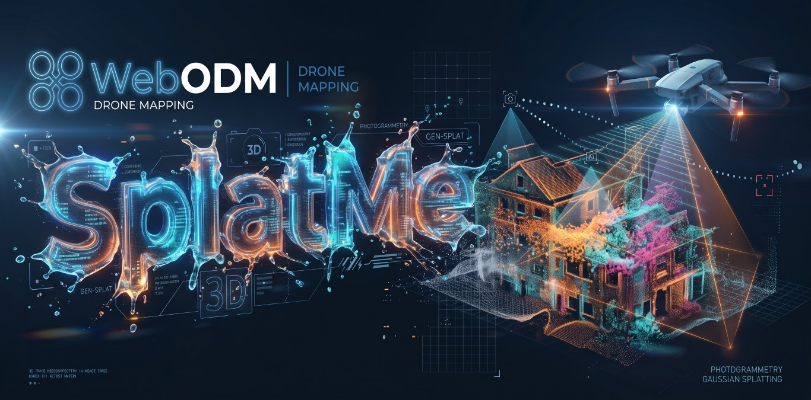
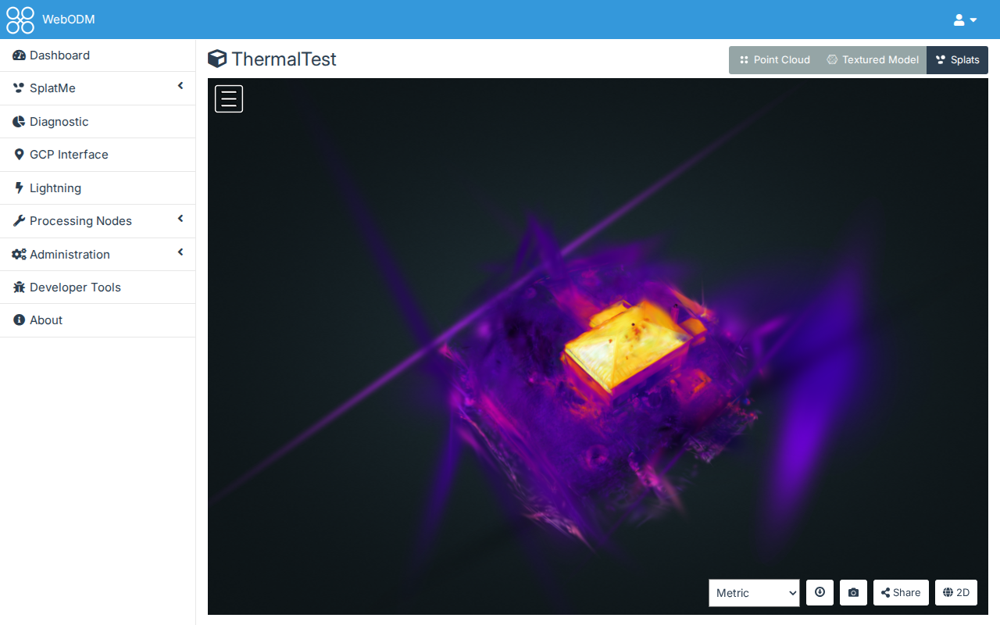

# SplatMe

A [WebODM](https://github.com/WebODM/WebODM) plugin that trains a task's Gaussian splats automatically via
[OpenSplat](https://github.com/WebODM/OpenSplat).

WebODM can export a task's training data and display a trained splat model, but the training itself is done by
hand in other software. SplatMe does that step: one button on its Tasks page trains a task's splats on a GPU and
puts the model in the task's 3D view. A task can also be set to train by itself when its processing completes.

**Status: experimental.** It has been used on WebODM 4.0.0 in Docker with an 8 GB NVIDIA GPU. See the
[releases](https://github.com/WinuxNomacs/webodm-splatme/releases) and the [changelog](changelog.md). Problems
and ideas go in the repository's [issues](https://github.com/WinuxNomacs/webodm-splatme/issues).

## Requirements

- **WebODM 4.0.0 or later, installed with Docker.** WebODM's native Windows app is not supported: it has no
  `splat-tools` to convert a trained model, and cannot build a plugin's page scripts. On an older WebODM,
  **Load Plugin (.zip)** says SplatMe was installed but WebODM then does not show it (and refuses it as already
  there): update WebODM first.
- **An NVIDIA GPU that Docker can use**, for the training container (the "splat node"), on WebODM's machine or
  another one: GTX 16 or RTX 20 to RTX 50 series, its driver, Docker with Docker Compose v2, and the
  [NVIDIA Container Toolkit](https://docs.nvidia.com/datacenter/cloud-native/container-toolkit/latest/install-guide.html).

## Where to Go Next

- **[Getting Started](getting-started.md)**: a fresh install from start to a first trained model, and an upgrade.
- [Install, Upgrade, Uninstall](install.md): the reference for each, and what an uninstall leaves.
- [Using SplatMe](using.md): training, its options, following a training, and training automatically.
- [The Splat Node](splat-node.md): the GPU container, its settings and API, and HTTPS to a node on another
  machine.
- [The Plugin's API](api.md) and [Development](development.md).

## Thanks

SplatMe is built on these projects:

- **[WebODM](https://github.com/WebODM/WebODM)** and its creator, **[Piero Toffanin](https://piero.dev/)**:
  SplatMe is a WebODM plugin, and reuses WebODM's export of a task's training data, its splat conversion and
  its 3D view.
- **[OpenSplat](https://github.com/WebODM/OpenSplat)**: the trainer in the splat node.
- **[ODX](https://github.com/WebODM/ODX)**: the sky model Ignore Sky uses.
- **[Splat-Tools](https://github.com/uav4geo/Splat-Tools)**: the conversion WebODM runs on a trained model for its
  3D view.
- **[PyTorch](https://pytorch.org)**: libtorch, which OpenSplat trains with.
