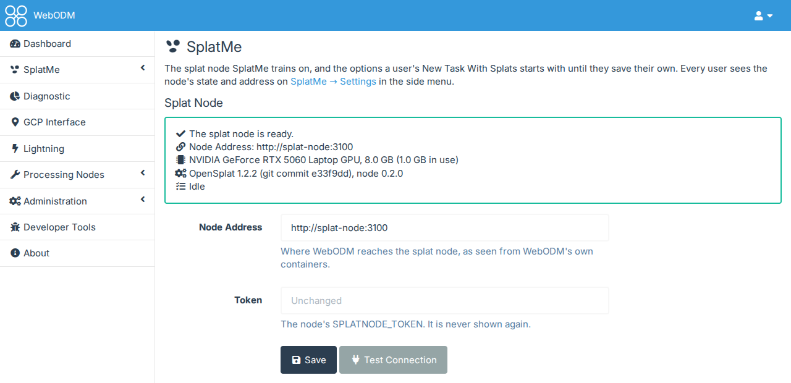

# Install, Upgrade, Uninstall

The reference for each. [Getting Started](getting-started.md) walks through a fresh install and an upgrade step by step, with what to expect.

## Install

By a WebODM administrator, in this order:

1. **The plugin**: in WebODM, **Administration → Plugins → Install Plugins**, find SplatMe (marked
    Experimental) and press **Install**. Or download `splatme-<version>.zip` from the
    [latest release](https://github.com/WinuxNomacs/webodm-splatme/releases/latest) and send it with **Load
    Plugin (.zip)** on the same page.
2. **Restart WebODM once**, with the options it was started with: `./webodm.sh restart` in WebODM's folder,
    plus any options given to `./webodm.sh start` (`--port`, `--hostname`, `--media-dir`, `--ssl`…), which
    `webodm.sh` does not remember. Until then SplatMe's pages fail now and then, and tasks are not trained by
    themselves (SplatMe → Settings, SplatMe's panel and a task set to train say so).
3. **The splat node**, on the machine with the GPU:

    ```
    curl -fsSL https://github.com/WinuxNomacs/webodm-splatme/releases/latest/download/splatnode.sh | bash -s install
    ```

    It downloads the node's image (4 GB; 6.6 GB once unpacked; deleted again when a container cannot use the GPU), checks the GPU and
    starts the node; a failed install is undone, so it can be run again. **On WebODM's machine** the node joins
    the Docker network of WebODM's worker, listens on that machine only, and SplatMe's settings get
    its address and token: there is nothing to enter. (With several WebODMs on the machine, it stops and names
    them: run it again with `--webodm <its webapp container>`. A node installed before the plugin is connected afterwards
    with `connect`, which also moves the node to a reinstalled WebODM's network.) **On another machine**, or with `--standalone`, it listens on port 3100 (`--port`) and
    prints its address and token: enter them on **Administration → SplatMe** in WebODM's side menu, where **Test
    Connection** says what is wrong (no answer, wrong token, no GPU, a node too old) before anything is saved.
    Every request to the node needs its token, but the connection is plain HTTP: let only WebODM's machine reach
    that port, or put an HTTPS proxy in front of it ([below](splat-node.md#https-to-a-node-on-another-machine)).

    These steps, each command with a **Copy** button, are also on **Administration → SplatMe**: in place of the
    node's state while no node is set, and behind **How to Install a Splat Node** under it once one is.

    

Then train a task on **SplatMe → Tasks**: see [Using SplatMe](using.md), or [Getting Started](getting-started.md) for a first training.

## Upgrade

Between trainings: a training running during an upgrade picks up again or fails with a message.

- **The plugin**: **Install Plugins** shows **Update** when a newer SplatMe is listed. With the zip instead:
    delete SplatMe on Administration → Plugins (its row's bin), then **Load Plugin (.zip)** with the new zip, which
    WebODM refuses while a plugin of that name is installed. Either way SplatMe's settings, users' options and tasks' trainings are
    kept (they are in WebODM's database, not in the plugin's folder). **Restart WebODM once** afterwards. The
    sky model is downloaded again by the next training with Ignore Sky, as an update replaces the plugin's folder.
- **The splat node**: `curl -fsSL …/splatnode.sh | bash -s upgrade` (the same address as above) downloads the
    newest image, restarts the node keeping its jobs, token and port, and
    deletes the previous image. While the node trains it asks first, as the restart fails that training; with no
    terminal to ask on it stops (`upgrade --force` goes on). SplatMe needs a node of version 0.2.0 or
    later, and **Test Connection** says when the node is older.

## Uninstall

- **The splat node**: `curl -fsSL …/splatnode.sh | bash -s uninstall` stops and removes the node and its folder
    (`~/splatnode`), and asks before deleting its jobs' data and its image, and, for a node on WebODM's machine,
    before removing it from SplatMe's settings (`--yes` answers yes to all).
- **The plugin**: its row's bin on Administration → Plugins removes the plugin's folder, with the sky model it
    downloaded. It leaves:
    - **The trained models**: each task keeps its model in its 3D view, as a model uploaded by hand, and the
      model as the trainer wrote it (`assets/splats/splatme-model.ply`, with the options it was trained with in
      `splatme-model.json`, kept for continuing a training), all deleted with the task. To delete only the kept
      ones (the tasks then cannot be continued):
      `docker exec webapp sh -c 'rm -f /webodm/app/media/project/*/task/*/assets/splats/splatme-model.*'`.
    - **SplatMe's settings and records** in WebODM's database (the node's address and token, the
      administrators' defaults, users' options, each task's training), which a reinstall finds again. To delete
      them:
      `docker exec webapp python manage.py shell -c "from app.models import PluginDatum; PluginDatum.objects.filter(key__startswith='splatme::').delete()"`.
