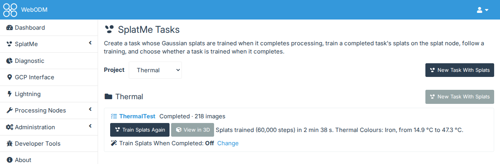
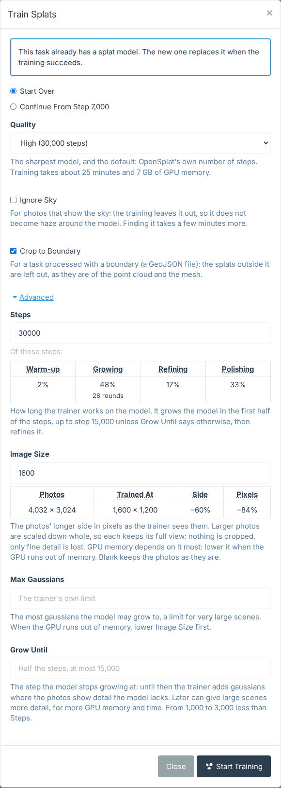

# Using SplatMe

Every user sees on **SplatMe → Settings** in the side menu whether the node is ready, its address, its GPU and
its queue (never the token, and what is wrong with the node only as "ask an administrator"). The node's address
and token are on **Administration → SplatMe** (staff see it, superusers change it), also at
`/plugins/splatme/admin/`.

1. **Train**: on **SplatMe → Tasks** in the side menu, which lists the tasks SplatMe can train in the projects
    the user can see (a **Project** filter narrows it), press **Train Splats** on a completed task. A task is
    listed when its photos are JPEG (or DJI Thermal Analyzer's TIFFs, below) and, once completed, it has what a
    training needs (a point cloud, its photos), or when it already has splats; a project with no such task is not
    listed. **New Task With Splats** above the
    list creates a task in any project the user may change, listed or not. Choose a **Quality**: Draft
    (3,000 steps), Standard (7,000), Fine (15,000) or High (30,000, the default: OpenSplat's own). On an 8 GB GPU
    at the default image size, training takes about 2, 5, 10 and 25 minutes and up to 3, 5, 5 and 7 GB of GPU
    memory, whatever the number of photos. The dialog says first if the task cannot be trained, and warns when
    nearly all photos point straight down.

    { width="400" }

    **Advanced** has the steps, the image size and the most gaussians as numbers:

    - **Steps**: the trainer grows the model (adds gaussians where the photos show detail it lacks) in the first
      half of the steps, up to step 15,000, then refines it; steps beyond 30,000 only refine it. A table under
      the number gives the share of the steps in each stage (**Warm-up**, **Growing**, **Refining**,
      **Polishing**), with how many times the model is grown; each heading's hover tip says what the stage does. A number of steps the trainer handles badly
      gets a note: up to 2,000 steps grows no new gaussians, and 3,001 to 5,999 trains worse than 3,000.
    - **Image Size** (1,600 by default): the photos' longer side as the trainer sees them. Larger photos are
      scaled down whole, so each keeps its full view: nothing is cropped, only fine detail is lost; smaller ones
      are not enlarged, and 0 keeps them as they are. It is what to lower when the GPU runs out of memory, which
      depends on it most. A table under the number gives the task's photo size (one row per camera), its size
      at the Image Size entered, and how much the longer side and the pixels change. Full-size photos cost far
      more: a training of 12-megapixel photos at 30,000 steps ran about 15 times slower than at 1,600 and
      filled an 8 GB GPU before its model had finished growing.
    - **Max Gaussians**: the most gaussians the model may grow to, a limit for very large scenes.

    **Ignore Sky** is for photos that show the sky, which a training otherwise turns into haze around the
    model: SplatMe finds the sky in each photo and the training leaves those pixels out. It looks only above
    each photo's horizon, known from where the camera pointed, so photos that look down are not searched. Finding the sky takes a few minutes more, and the task's line then says in how many photos it was found. The first training
    with it downloads the sky model (180 MB, the one ODX uses for its sky removal) from ODX's releases on
    github.com into WebODM's media folder (`plugins/splatme/models`), so WebODM must reach that address once.

    **Crop to Boundary** shows for a task that was processed with a boundary (a GeoJSON file in WebODM's
    Boundary option) and is ticked: the splats outside the boundary (or in one of its holes) are left out of the
    model the task shows, as the processing leaves them out of the point cloud and the mesh. The training itself still sees the
    photos whole, and the model kept for continuing is not cropped.

    **Thermal tasks**: a task made by the DJI Thermal Analyzer plugin's **DJI Thermal Task** button holds TIFFs of
    temperatures, which SplatMe draws as pictures to train on. It uses one range for the whole task, from its coldest to its hottest pixels (the coldest and hottest 1% left
    out), so a surface has the same colour in every photo. **Thermal Colours** in the dialog, which takes the
    place of Ignore Sky, chooses the palette: Grayscale (white is hot, the default), Black Hot, Iron, Magma,
    Inferno, Plasma, Viridis, Cividis or Jet. The task's line then
    names the palette and the temperatures it spans, in WebODM's unit system. Thermal photos are small (640 × 512
    on DJI's M4T): training takes about a quarter of the times above and about 1 GB of GPU memory, and Fine is
    much sharper than Standard. TIFFs from other software are not listed.

    A task SplatMe has trained can be trained further instead of starting over: **Train Splats Again** then opens with
    **Start Over** and **Continue From Step** (the steps the model has), and continuing asks only **More
    Steps**. The other options stay as the model was trained. Continuing sharpens the model the task has: the
    model grows only before half the new total of steps (and before step 15,000), so continuing a model by as
    many steps again, or fewer, adds no gaussians (the steps table says so), and a model that lacks detail
    everywhere is better started over at a higher Quality. Processing the task again, or uploading another model in WebODM's Splats dialog, ends what can
    be continued. A task processed again while its splats train has that training canceled (its model would not
    fit the new results), and is trained again on the new results when it is set to Train Splats When Completed.
2. **Follow it**: the task's row shows the stage (while training, the step, such as "Step 4,650 of 7,000,
    about 12 min left": the time the steps left take at the rate of the last few minutes, once it can tell), a
    progress bar, **Cancel** and **Show Log** (the trainer's output), to everyone who can see the task and after
    a reload. When it is done, **View in 3D** opens the model; **Edit** and **Download .ply** are in [Editing
    Splats](editing.md). A task that cannot be trained (failed or canceled
    processing; for users who may only look at the project, any task) says why.

    On the Dashboard, a task's panel has a **Splats** line under its Task ID ("Trained, 7,000 steps", or the
    training's step) with **Open in SplatMe**, which opens the Tasks page at that task (for a task SplatMe can
    train; another says why SplatMe does not list it). A task's name on the Tasks page opens the Dashboard at its
    panel, with only its project shown.

3. **Train automatically**: on **SplatMe → Tasks**, press **New Task With Splats** in a project's heading
    (or beside **Select Images and GCP** in a project on the Dashboard, which opens it there) and pick the
    photos, with a GCP file and other text files if the task has them. WebODM's own New Task panel opens (name,
    processing node, options, resize, alignment), with SplatMe's panel above it: **Train Splats When
    Completed**, ticked, with the Quality, Ignore Sky (or Thermal Colours when the photos picked are TIFFs), Crop
    To Boundary and Advanced. While Train Splats When Completed is ticked, photos SplatMe cannot train (not JPEG,
    nor all DJI Thermal Analyzer's TIFFs) are named there and hold up Start Processing. On **Start Processing**,
    SplatMe creates the task through WebODM's API, saves its training setting, uploads the files and starts its processing; the row then follows the
    processing (its progress, and WebODM's error if it fails) and the training. If some files still fail,
    **Try Again** sends them, or **Cancel** removes the task. Leaving the page during the upload stops it, and
    another New Task With Splats waits until it is done.
    Unticked, or made from WebODM's own Select Images and GCP, the task is an ordinary one. The panel
    starts with the user's own options, saved on **SplatMe → Settings** (**New Task With Splats**); until they
    save some, with the administrators' defaults from **Administration → SplatMe** (High until they change
    them). On **SplatMe → Tasks**, a task's row shows **Train Splats When Completed** (On or Off), with **Change**
    for those who may train it, which switches the training on or off and changes its options. A training that could not start shows on the task
    as a failed training, with the reason.

Training needs the right to change the task's project. The trained model replaces the task's splat model only
when training succeeds, and then shows in the task's 3D view like a model uploaded by hand; the model as the
trainer wrote it is kept in the task's folder (`data/splatme/splatme-model.ply`, about 250 bytes per gaussian) for continuing, and counts in the
task's size.

Trainings waiting on the node do not hold up WebODM's own processing.
